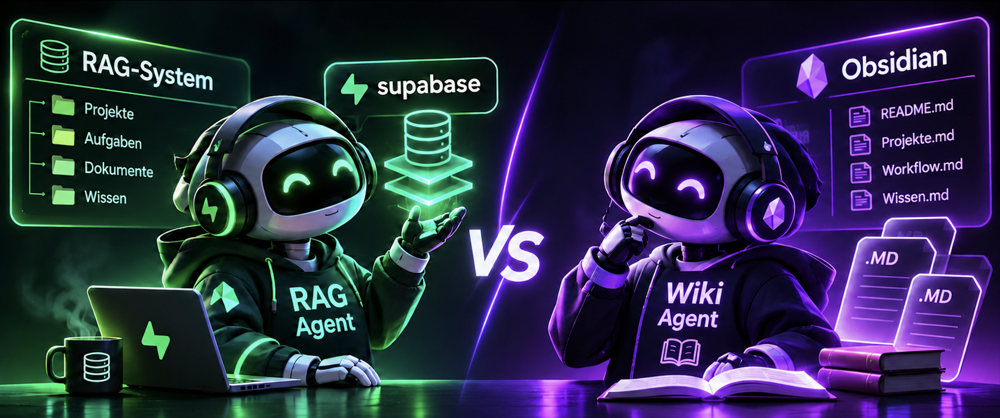
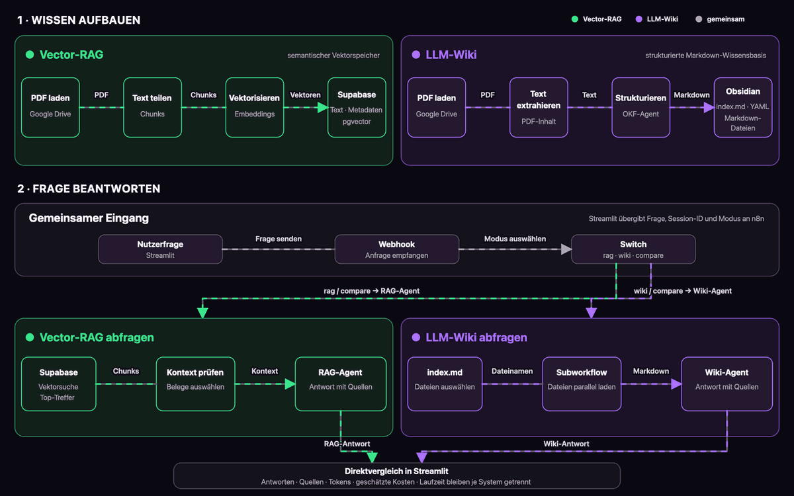

# RAG vs. LLM-Wiki

## Zwei Wissensarchitekturen im direkten Vergleich

  

In diesem Projekt vergleiche ich zwei Wege, Unternehmenswissen für einen KI-Assistenten nutzbar zu machen: ein klassisches Vector-RAG und ein dateibasiertes LLM-Wiki. Beide Systeme arbeiten mit denselben Informationen, suchen und strukturieren sie aber unterschiedlich.

Als Testfall dient ein fiktiver Elektroinstallationsbetrieb. Der Assistent beantwortet Fragen zu Projekten, offenen Arbeiten, technischen Mängeln, Zahlungen und nächsten Schritten. Namen und Geschäftsdaten sind frei erfunden.

### Projekt in zwei Minuten ansehen

Der Screencast zeigt die Gesamtarchitektur, Supabase, Obsidian, die n8n-Orchestrierung und einen abschließenden Direktvergleich in der Streamlit-Oberfläche.

[▶ Screencast ansehen](screencast/rag-vs-llm-wiki-screencast.mp4)

## Die Projektidee

Ausgangspunkt war ein klassisches RAG-System für die semantische Suche in Dokumenten. Mich interessierte, wie sich dieser Ansatz im Alltag gegen ein strukturiertes Wiki schlägt. Dort beginnt der Agent mit einem zentralen Index, wählt passende Markdown-Dateien aus und liest nur die Informationen ein, die er für die Frage benötigt.

Die Idee für den zweiten Ansatz geht auf Andrej Karpathys Konzept eines [LLM Wiki](https://gist.github.com/karpathy/442a6bf555914893e9891c11519de94f) zurück. Wissen wird dabei nicht bei jeder Frage erneut aus einzelnen Dokumentfragmenten zusammengesetzt, sondern dauerhaft in einer strukturierten Markdown-Wissensbasis abgelegt. Google Cloud greift eine ähnliche Idee mit dem [Open Knowledge Format (OKF)](https://github.com/GoogleCloudPlatform/open-knowledge-format) auf.

Für den Wiki-Zweig habe ich zentrale Strukturprinzipien von OKF 0.2 übernommen. Ein n8n-Agent erzeugt einzelne Markdown-Dateien mit YAML-Frontmatter, Typ, Beschreibung, Status und Quellen. Die `index.md` dient als Einstiegspunkt; relative Links verbinden Projekte, Personen, Unternehmen und Übersichten. Bei einer Frage liest der Wiki-Agent zuerst den Index und anschließend nur die relevanten Dateien.

Das Projekt macht beide Ansätze über dieselbe Oberfläche nutzbar und direkt vergleichbar:

- **Vector-RAG:** semantische Suche mit OpenAI Embeddings und Supabase `pgvector`
- **LLM-Wiki:** strukturierter Zugriff auf ein Obsidian-Wiki mit `index.md` und Markdown-Dateien
- **Direktvergleich:** parallele Beantwortung derselben Frage durch beide Wissensarchitekturen

Die eingebettete Grafik ist eine GIF-Vorschau. [Vollständige animierte Systemtopologie öffnen](topologie/systemtopologie.html).

## Funktionen

- natürlichsprachliche Abfragen interner Projektdokumente
- nachvollziehbare Quellenangaben
- fortlaufende Chatverläufe über PostgreSQL Memory
- getrennte Messwerte für Tokens, geschätzte Kosten und Antwortzeit
- Vergleich von Vector-RAG und LLM-Wiki in einer gemeinsamen Streamlit-Oberfläche
- Orchestrierung der Agenten, Tools und Datenquellen mit n8n

## Technischer Aufbau

| Bereich | Umsetzung |
|---|---|
| Orchestrierung | n8n, lokal über Docker |
| Benutzeroberfläche | Streamlit |
| Vector-RAG | Supabase PostgreSQL, `pgvector`, OpenAI Embeddings |
| LLM-Wiki | Obsidian, OKF-0.2-orientierte Markdown-Struktur, zentraler Dateiindex, n8n-Subworkflow |
| Sprachmodell | OpenAI `gpt-5-mini` |
| Gesprächsspeicher | PostgreSQL Chat Memory |
| Dokumentenaufnahme | Google Drive, PDF-Extraktion, Chunking und Embeddings |

## Projektstatus

Der erste funktionsfähige Prototyp steht. Über die Streamlit-Oberfläche lassen sich Vector-RAG, LLM-Wiki und der Direktvergleich auswählen. Beide Agenten liefern Quellen sowie getrennte Angaben zu Laufzeit, Tokenverbrauch und geschätzten Kosten. Ein Screencast dokumentiert den Aufbau und einen vollständigen Testlauf.

Die README gibt einen kurzen Überblick. Die ausführliche Projektvorstellung und die Systemtopologie ergänzen die technischen Details.

## Entwicklungsstand

| Version | Schwerpunkt | Status |
|---|---|---|
| `v0.1` | Dokumentenaufnahme und klassisches Vector-RAG mit Supabase | abgeschlossen |
| `v0.2` | LLM-Wiki mit Obsidian, Dateiindex und n8n-Subworkflow | abgeschlossen |
| `v0.3` | Gemeinsame Streamlit-Oberfläche und direkter Vergleich | aktueller Prototyp |
| `v0.4` | Erweiterter Dokumentenbestand und systematische Evaluation | geplant |

## Ausblick

In `v0.4` möchte ich den Dokumentenbestand erweitern und beide Systeme mit demselben Fragenkatalog testen. Zu jeder Frage wird vorab festgehalten, welche Antwort und welche Quellen erwartet werden. So lässt sich der Vergleich nachvollziehbar wiederholen.

Untersucht werden unter anderem:

- Antwortqualität und korrekte Quellenverwendung
- Mehrdokument-Fragen und Wissensverknüpfung
- Verhalten bei aktualisierten Dokumenten
- Halluzinationen und nicht belegte Aussagen
- Antwortzeit, Tokenverbrauch und geschätzte API-Kosten
- wiederholte Tests unter denselben Bedingungen

## Weiterführende Inhalte

- [Ausführliche Projektvorstellung](projektvorstellung/PROJEKTVORSTELLUNG.md)
- [Animierte Systemtopologie](topologie/systemtopologie.html)
- [GIF-Vorschau der Topologie](topologie/systemtopologie-preview.gif)
- [Screencast der funktionierenden Anwendung](screencast/rag-vs-llm-wiki-screencast.mp4)
