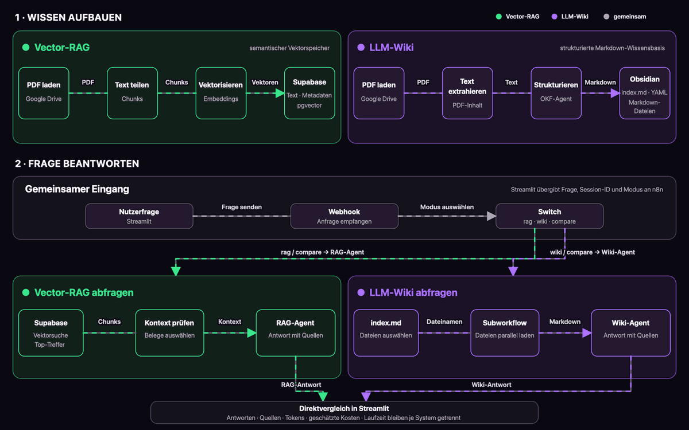
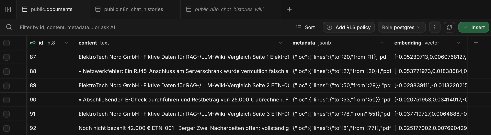
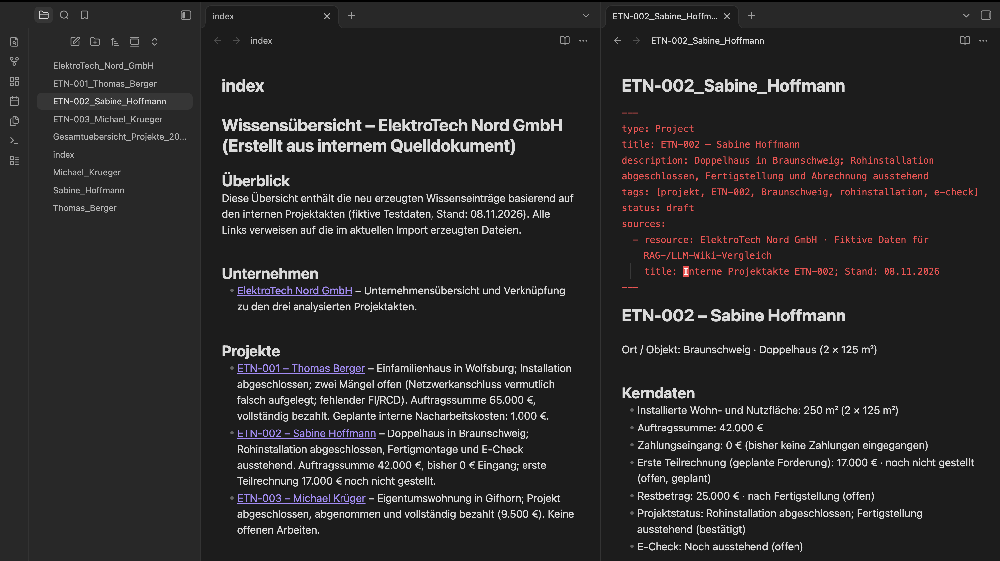
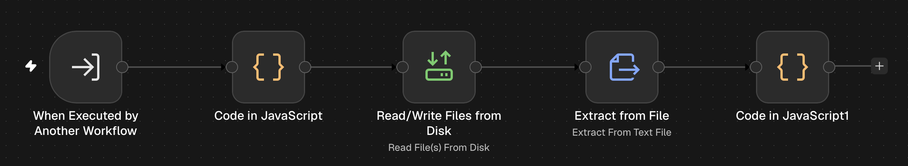
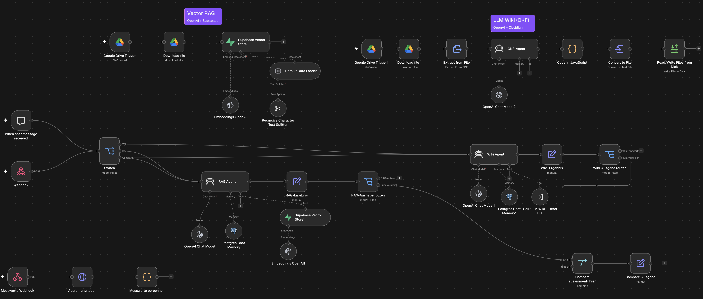
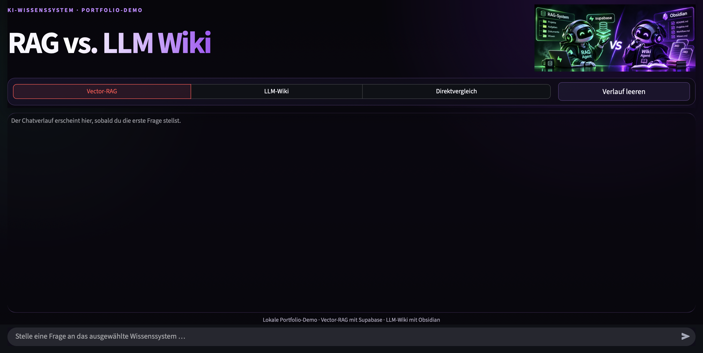
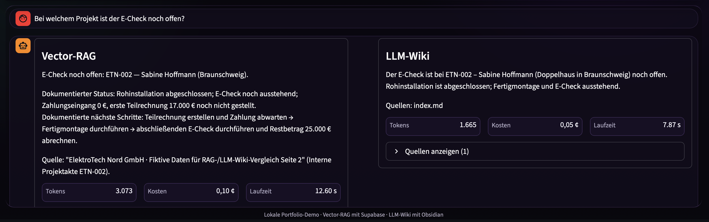

# Projektvorstellung: RAG vs. LLM-Wiki

## Zwei Wege, dieselben Unternehmensdaten abzufragen

In diesem Projekt vergleiche ich ein klassisches Vector-RAG mit einem strukturierten LLM-Wiki. Beide Systeme greifen auf dieselben fiktiven Unternehmensinformationen zu, bereiten das Wissen jedoch unterschiedlich auf und rufen es auf unterschiedlichen Wegen ab.

Als Testfall dient die fiktive ElektroTech Nord GmbH. Die Dokumente beschreiben Kundenprojekte, Installationsleistungen, offene Mängel, Zahlungen und nächste Arbeitsschritte. Über eine gemeinsame Streamlit-Oberfläche lassen sich Fragen wahlweise an das RAG-System, das LLM-Wiki oder beide Systeme gleichzeitig stellen.

> **Hinweis:** Sämtliche Namen, Projekte, Beträge und Geschäftsdaten wurden ausschließlich für diesen Prototyp erstellt.

## Inhalt

1. [Ausgangslage und Motivation](#1-ausgangslage-und-motivation)
2. [Zielsetzung](#2-zielsetzung)
3. [Gesamtarchitektur](#3-gesamtarchitektur)
4. [Dokumentenaufnahme](#4-dokumentenaufnahme)
5. [Vector-RAG mit Supabase](#5-vector-rag-mit-supabase)
6. [LLM-Wiki mit Obsidian und OKF 0.2](#6-llm-wiki-mit-obsidian-und-okf-02)
7. [Orchestrierung mit n8n](#7-orchestrierung-mit-n8n)
8. [Streamlit-Oberfläche](#8-streamlit-oberfläche)
9. [Direktvergleich und Messwerte](#9-direktvergleich-und-messwerte)
10. [Technische Optimierungen](#10-technische-optimierungen)
11. [Erste Erkenntnisse](#11-erste-erkenntnisse)
12. [Grenzen und nächste Schritte](#12-grenzen-und-nächste-schritte)

## 1. Ausgangslage und Motivation

Der erste Teil des Projekts war ein klassisches RAG-System. Neue PDF-Dokumente werden automatisch verarbeitet, in kleinere Textabschnitte zerlegt und als Embeddings in Supabase gespeichert. Der RAG-Agent sucht bei einer Frage nach semantisch passenden Abschnitten und verwendet sie als Kontext für seine Antwort.

Während der Umsetzung stellte sich eine zweite Frage: Muss ein Agent Wissen bei jeder Anfrage erneut aus einzelnen Chunks zusammensetzen, oder kann eine vorstrukturierte Wissensbasis für bestimmte Aufgaben besser geeignet sein?

Den Anstoß für diese Alternative gab Andrej Karpathys Konzept eines [LLM Wiki](https://gist.github.com/karpathy/442a6bf555914893e9891c11519de94f). Das Sprachmodell arbeitet dabei nicht nur mit Rohdokumenten, sondern baut daraus eine dauerhafte, verlinkte Markdown-Wissensbasis auf. Google Cloud beschreibt mit dem [Open Knowledge Format](https://github.com/GoogleCloudPlatform/open-knowledge-format) inzwischen ein offenes Format für solche menschen- und agentenlesbaren Wissensbestände.

Aus dieser Idee entstand der direkte Vergleich: dieselben Daten, dasselbe generative Sprachmodell und dieselbe Benutzeroberfläche – aber zwei unterschiedliche Wege zum benötigten Wissen.

## 2. Zielsetzung

Ziel war kein rein theoretischer Architekturvergleich. Beide Ansätze sollten als funktionsfähige Prototypen umgesetzt und unter möglichst vergleichbaren Bedingungen gegenübergestellt werden.

Die wichtigsten Anforderungen waren:

- eine gemeinsame Datenbasis für beide Ansätze,
- ein möglichst vergleichbares generatives Sprachmodell,
- eine einheitliche Oberfläche mit den Modi RAG, Wiki und Direktvergleich,
- nachvollziehbare Quellen,
- getrennte Angaben zu Laufzeit, Tokenverbrauch und geschätzten Kosten,
- ein fortlaufender Chatverlauf je Wissenssystem,
- eine Architektur, die sich später mit weiteren Dokumenten und Testfragen erweitern lässt.

## 3. Gesamtarchitektur

Die Architektur trennt zwei Vorgänge: den Aufbau der Wissensbasis und die spätere Beantwortung einer Frage. Beide Systeme erhalten inhaltlich dieselben Quelldokumente, bereiten sie jedoch unterschiedlich auf. Das Vector-RAG speichert Textabschnitte und Embeddings in Supabase. Der Wiki-Zweig erzeugt dagegen eine verlinkte Markdown-Struktur mit zentraler `index.md` in Obsidian.



**Abbildung 1:** Gesamtarchitektur vom Dokumentenimport über die beiden Wissenspfade bis zur Abfrage und zum Direktvergleich in Streamlit.

Die eingebettete Abbildung ist eine GIF-Vorschau. Die vollständige animierte Version liegt im Repository unter [`topologie/systemtopologie.html`](../topologie/systemtopologie.html). Die Grafik konzentriert sich auf den Informationsfluss zwischen den Komponenten; Kapitel 7 zeigt anschließend die konkrete Umsetzung mit n8n-Nodes.

Bei einer Anfrage übergibt Streamlit die Frage und den gewählten Modus an n8n. Der Switch aktiviert den RAG-Agenten, den Wiki-Agenten oder beide Zweige parallel. Jeder Agent greift ausschließlich auf den zugehörigen Wissensspeicher zu. Erst in der Oberfläche werden Antworten, Quellen und Messwerte wieder zusammengeführt und getrennt gegenübergestellt.

## 4. Dokumentenaufnahme

Beide Wissenssysteme beginnen mit PDF-Dokumenten aus Google Drive, verarbeiten sie danach aber unterschiedlich.

### RAG-Pipeline

Der Google Drive Trigger erkennt eine neu angelegte Datei im vorgesehenen Ordner. n8n lädt die PDF herunter und übergibt sie an den Document Loader. Ein Recursive Character Text Splitter teilt den extrahierten Text in überlappende Abschnitte. Im Prototyp werden ungefähr 1.000 Zeichen pro Chunk und 100 Zeichen Überlappung verwendet.

OpenAI erzeugt für jeden Abschnitt ein Embedding. Text, Metadaten und Vektor werden anschließend in der Supabase-Tabelle `documents` gespeichert.

```text
Google Drive → PDF-Download → Textaufteilung → Embeddings → Supabase
```

### Wiki-Pipeline

Für das LLM-Wiki überwacht ein zweiter Google Drive Trigger einen eigenen Eingangsordner. Nach Download und Textextraktion analysiert der OKF-Agent das gesamte Dokument. Er identifiziert eigenständige Wissenseinheiten wie Projekte, Personen, Unternehmen, Statusinformationen und Finanzübersichten.

Die Ausgabe erfolgt als strukturiertes JSON. Ein JavaScript-Node zerlegt das Ergebnis in einzelne Dateien, wandelt die Inhalte in Textdateien um und schreibt sie in das lokale Obsidian-Verzeichnis.

```text
Google Drive → PDF-Download → Textextraktion → OKF-Agent → Markdown-Dateien → Obsidian
```

Beide Verarbeitungspfade sind in der Systemtopologie in Abbildung 1 zusammengefasst. Die folgenden Kapitel betrachten Speicherung und Abfrage der beiden Wissenssysteme getrennt.

## 5. Vector-RAG mit Supabase

Das RAG-System verwendet Supabase PostgreSQL mit der Erweiterung `pgvector`. Bei der Dokumentenaufnahme werden Text-Chunk, Metadaten und Embedding gemeinsam in der Tabelle `documents` gespeichert.



**Abbildung 2:** Supabase-Tabelle `documents` mit Text-Chunks, Metadaten und den zugehörigen Embedding-Vektoren.

Bei einer Nutzerfrage wird die Frage mit demselben Embedding-Modell vektorisiert, das auch bei der Dokumentenaufnahme verwendet wurde. Die PostgreSQL-Funktion `match_documents` sucht anschließend nach semantisch ähnlichen Abschnitten. Der Supabase Vector Store ist als Tool mit dem RAG-Agenten verbunden und liefert aktuell bis zu acht passende Treffer zurück.

Der Agent erhält nicht den gesamten Dokumentenbestand, sondern nur die vom Tool gefundenen Textabschnitte. Das begrenzt den Kontext auch bei größeren Datenmengen. Projektübergreifende Fragen können allerdings mehrere Suchschritte oder eine geeignete Kombination der Treffer erfordern.

Der Systemprompt verpflichtet den Agenten dazu,

- bei betrieblichen Fragen immer den Vector Store zu verwenden,
- bestätigte Fakten, Vermutungen und geplante Maßnahmen zu unterscheiden,
- Finanzbegriffe wie Auftragssumme, Zahlungseingang und Nacharbeitskosten nicht zu vermischen,
- fehlende Angaben offen zu benennen,
- keine Quellen oder Maßnahmen zu erfinden.

## 6. LLM-Wiki mit Obsidian und OKF 0.2

Der zweite Wissenspfad orientiert sich an zentralen Strukturprinzipien des Open Knowledge Format 0.2. Statt ein Dokument in voneinander unabhängige Chunks zu zerlegen, überführt der Workflow seinen Inhalt in verknüpfte Markdown-Dateien.

### Wissensaufbau durch den OKF-Agenten

Der Begriff **OKF-Agent** bezeichnet in diesem Projekt den Agenten, der Quelldokumente analysiert und daraus die strukturierte Wiki-Basis erzeugt. Damit ist keine offizielle OKF-Referenzimplementierung gemeint.

Für jede erkannte Wissenseinheit erzeugt der OKF-Agent eine eigene Markdown-Datei. Am Anfang jeder Konzeptdatei steht ein YAML-Frontmatter: ein maschinenlesbarer Metadatenblock aus Schlüssel-Wert-Paaren. Die Reihenfolge der Felder ist technisch nicht entscheidend; im Prototyp werden sie für eine einheitliche Struktur dennoch nach demselben Schema ausgegeben.

```yaml
---
type: Project
title: ETN-001 – Thomas Berger
description: Einfamilienhaus in Wolfsburg; zwei Nacharbeiten offen
tags: [projekt, ETN-001, Wolfsburg]
status: draft
sources:
  - resource: internes Quelldokument
    title: Projektakte ETN-001
---
```

**Codebeispiel 1:** Vereinfachtes YAML-Frontmatter einer vom OKF-Agenten erzeugten Projektdatei.

Die eigentlichen Fachinformationen stehen unterhalb dieses Metadatenblocks. Relative Markdown-Links verbinden zusammengehörige Einträge, beispielsweise ein Projekt mit der betreffenden Person, dem Unternehmen und einer Projektübersicht.

### Die `index.md` als Einstiegspunkt

Zusätzlich erzeugt der Workflow eine zentrale `index.md`. Sie dient als Inhaltsverzeichnis und verweist auf die vorhandenen Wissenseinträge. Bei fachlichen Fragen arbeitet der Wiki-Agent deshalb in zwei Schritten:

1. Er liest zuerst ausschließlich die `index.md`.
2. Danach fordert er die für die Frage relevanten Dateien an.



**Abbildung 3:** Links ist die bereinigte Dateistruktur der Obsidian-Wissensbasis zu sehen, in der Mitte die gerenderte `index.md` mit Verweisen auf Projekte und Personen. Rechts zeigt die Projektakte `ETN-002_Sabine_Hoffmann` den YAML-Metadatenblock und die zugehörigen Projektdaten.

Damit erhält der Agent zunächst nur eine Übersicht über den Bestand. Die ausführlichen Inhalte werden erst geladen, wenn sie für die konkrete Frage benötigt werden.

### Kontrollierter Dateizugriff über den Subworkflow

Der Wiki-Agent greift nicht frei auf das Dateisystem zu. Er ruft das Tool `LLM Wiki – Read File` auf und übergibt ihm höchstens drei ausgewählte Dateinamen. Der Subworkflow übernimmt anschließend drei Aufgaben:

1. Er prüft, ob einfache Markdown-Dateinamen übergeben wurden. Absolute Pfade, Unterverzeichnisse und andere Dateitypen werden abgelehnt.
2. Er liest die freigegebenen Dateien innerhalb eines gemeinsamen Workflow-Aufrufs und extrahiert ihren Text.
3. Er gibt Dateiname und Inhalt als strukturierte Dokumentenliste an den Wiki-Agenten zurück.



**Abbildung 4:** Subworkflow „LLM Wiki – Read File“ vom Eingang der Dateinamen bis zur strukturierten Rückgabe an den Wiki-Agenten.

Fachliche Auswahl und technischer Dateizugriff bleiben damit getrennt: Der Agent wählt die benötigten Einträge aus, der Subworkflow prüft und liest sie. Da bis zu drei Dateien gebündelt übergeben werden können, genügt dafür ein gemeinsamer Tool-Aufruf.

## 7. Orchestrierung mit n8n

Der veröffentlichte Hauptworkflow `RW_RAG_vs_LLM_Wiki` umfasst derzeit 37 Nodes. Der Wiki-Dateizugriff liegt in einem separaten, ebenfalls veröffentlichten Subworkflow mit fünf Nodes.

Die abstrakte Architektur aus Abbildung 1 wird im Hauptworkflow technisch umgesetzt. Im oberen Bereich liegen die beiden Pipelines für die Dokumentenaufnahme. Der untere Bereich verarbeitet Fragen aus dem n8n Chat Trigger oder dem Streamlit-Webhook, leitet sie an die Agenten weiter und führt die Ergebnisse für den Direktvergleich zusammen. Ein separater Zweig lädt anschließend die Ausführungsdaten und berechnet die Messwerte.



**Abbildung 5:** Technische Umsetzung der Gesamtarchitektur in n8n: Dokumentenaufnahme oben, Agenten und Modussteuerung in der Mitte sowie Messwertverarbeitung im unteren Bereich.

### Modussteuerung

Die Streamlit-App sendet mit jeder Frage einen Modus:

- `rag` für Vector-RAG,
- `wiki` für das LLM-Wiki,
- `compare` für beide Systeme.

Der Switch unterstützt sowohl Webhook-Daten aus `body.mode` als auch interne Testdaten aus `mode`. Im Compare-Modus werden beide Agentenzweige innerhalb derselben Ausführung angestoßen. Nach ihrem Abschluss werden die Antworten zusammengeführt, ohne die Messwerte der beiden Systeme zu vermischen.

### Gesprächsverlauf

Beide Agenten besitzen einen eigenen, in PostgreSQL gespeicherten Chatverlauf:

- `n8n_chat_histories_RAG`
- `n8n_chat_histories_Wiki`

Die Streamlit-App erzeugt eine Sitzungs-ID und sendet sie bei jeder Nachricht mit. Dadurch können Folgefragen auf den bisherigen Gesprächsverlauf Bezug nehmen, während die beiden Wissenssysteme getrennte Erinnerungen behalten.

### Sprachmodell

Beide Antwortagenten verwenden `gpt-5-mini`. Die maximale Antwortlänge ist derzeit auf 1.000 Tokens begrenzt. Damit bleibt genügend Spielraum für belegte Mehrdokument-Antworten, ohne unbegrenzt lange Ausgaben zuzulassen.

## 8. Streamlit-Oberfläche

Die Streamlit-App ist als lokale Präsentationsoberfläche ausgelegt. Das dunkle, grün-violette Design greift die beiden Wissenspfade auch visuell auf.

Über die Auswahl am oberen Rand stehen drei Modi zur Verfügung:

- **Vector-RAG**
- **LLM-Wiki**
- **Direktvergleich**

Der Chatverlauf bleibt während einer Sitzung erhalten und kann über eine Schaltfläche geleert werden. Im Direktvergleich erscheinen beide Antworten nebeneinander. Unter jeder Antwort stehen die zugehörigen Messwerte, damit nicht nur die Inhalte, sondern auch Aufwand und Laufzeit vergleichbar bleiben.

Die Webhook-Adressen werden über Umgebungsvariablen eingebunden. Dadurch bleibt die Oberfläche von der konkreten n8n-Installation getrennt.



**Abbildung 6:** Streamlit-Startansicht mit Vector-RAG, LLM-Wiki und Direktvergleich als auswählbaren Modi.

### Screencast des Gesamtsystems

Der Screencast führt durch die Gesamtarchitektur, Supabase, Obsidian und die n8n-Orchestrierung. Zum Abschluss zeigt er einen vollständigen Testlauf im Direktvergleich. Die folgenden Kapitel dokumentieren die Messwerte, technischen Optimierungen und bisherigen Erkenntnisse ausführlicher.

[▶ Screencast öffnen](../screencast/rag-vs-llm-wiki-screencast.mp4)

## 9. Direktvergleich und Messwerte

Für den Compare-Modus beantworten beide Agenten dieselbe Frage. Der Workflow führt die Ergebnisse erst nach Abschluss beider Zweige zusammen. Die Streamlit-App stellt sie anschließend getrennt dar.

Der separate `Messwerte Webhook` lädt die n8n-Ausführungsdaten anhand der Execution-ID. Der Code-Node `Messwerte berechnen` ermittelt daraus für jeden Zweig:

- Input-Tokens,
- Output-Tokens,
- Gesamt-Tokens,
- geschätzte Modellkosten,
- Laufzeit,
- erkannte Quellen.

Die Kosten werden aus den erfassten Input- und Output-Tokens berechnet. Dafür sind derzeit 0,25 US-Dollar pro Million Input-Tokens und 2,00 US-Dollar pro Million Output-Tokens für `gpt-5-mini` hinterlegt. Das Ergebnis ist ein Vergleichswert und kein aus der OpenAI-Abrechnung übernommener Rechnungsbetrag. Embedding-, Supabase- und Infrastrukturkosten sind nicht enthalten. Auch die Laufzeit wird pro Agentenzweig berechnet; im Direktvergleich zeigt die Oberfläche beide Werte getrennt an.



**Abbildung 7:** Beide Systeme beantworten dieselbe Frage. Antworten, Quellen, Tokenverbrauch, geschätzte Modellkosten und Laufzeiten bleiben getrennt sichtbar.

Diese Messung ist noch keine wissenschaftliche Evaluation. Sie schafft aber die technische Grundlage für die geplante Version `v0.4`, in der beide Systeme mit einem festen Fragenkatalog mehrfach getestet werden.

## 10. Technische Optimierungen

Während der Entwicklung wurden mehrere Punkte überarbeitet:

### Kompaktere Systemprompts

Die Antwortagenten erhielten kürzere, stärker auf ihre Aufgaben zugeschnittene Prompts. Regeln zu Quellen, Status und Finanzen blieben erhalten, während Wiederholungen entfernt wurden.

### Begrenzte Antwortlänge

Die maximale Ausgabe wurde zunächst auf 500 und nach weiteren Tests auf 1.000 Tokens gesetzt. Die höhere Grenze verhindert, dass belegte Antworten mit mehreren Informationen vorzeitig abbrechen. Die Systemprompts halten einfache Antworten weiterhin kompakt.

### Kein Wiki-Zugriff bei Small Talk

Der Wiki-Agent lädt bei Begrüßungen oder Dankesnachrichten nicht mehr automatisch die `index.md`. Das spart einen Tool-Aufruf.

### Gebündelter Mehrdateienabruf

Relevante Wiki-Dateien werden in einem Array gesammelt und über einen gemeinsamen Subworkflow-Aufruf gelesen. Im Prototyp sind höchstens drei Dateien pro Abruf erlaubt. Das reduziert wiederholte Tool-Aufrufe des Agenten und begrenzt gleichzeitig den Umfang des bereitgestellten Kontexts.

### Getrennte Vergleichswerte

Tokens, Kosten und Laufzeit werden für RAG und Wiki separat berechnet. Eine zusammengezählte Zahl wäre für den Architekturvergleich wenig aussagekräftig.

## 11. Erste Erkenntnisse

Der aktuelle Dokumentenbestand ist noch zu klein für ein abschließendes Urteil. Trotzdem zeigen sich bereits Unterschiede:

- **Vector-RAG** findet Informationen schnell über semantische Ähnlichkeit und eignet sich gut für größere unstrukturierte Dokumentbestände.
- **Das LLM-Wiki** macht Beziehungen, Status und Quellen bereits in der Wissensstruktur sichtbar. Der Agent kann über den Index gezielt zu zusammengehörigen Dateien navigieren.
- **Beim RAG liegt ein größerer Teil der Arbeit in der Abfrage**, weil passende Chunks gesucht und für die Antwort kombiniert werden.
- **Beim Wiki liegt ein größerer Teil der Arbeit in der Aufbereitung**, weil Wissen bereits beim Einlesen strukturiert, verlinkt und mit Metadaten versehen wird.

Eine weitere Architekturentscheidung betrifft den Zeitpunkt der Recherche. Derzeit entscheiden beide Agenten zunächst anhand der Nutzerfrage, ob sie ihr jeweiliges Werkzeug benötigen. Small Talk bleibt dadurch ohne Zugriff auf Supabase oder das Wiki. Fachliche Anfragen erfordern allerdings einen zusätzlichen Modellschritt, bevor die Vektorsuche beziehungsweise die `index.md` aufgerufen wird. Alternativ könnten beide Systeme ihren Wissenszugriff vor dem ersten Modellaufruf ausführen. Das dürfte die Latenz fachlicher Antworten verringern, würde aber auch bei einfachen oder fachfremden Nachrichten unnötig Kontext laden. Welche Variante für den Vergleich geeigneter ist, soll deshalb in `v0.4` getrennt gemessen werden.

In einzelnen Testläufen war das RAG-System schneller. Daraus lässt sich mit nur wenigen Dokumenten und ohne wiederholte Messungen noch kein allgemeines Ergebnis ableiten.

## 12. Grenzen und nächste Schritte

Der derzeitige Stand ist ein funktionsfähiger Prototyp, keine produktionsfertige Unternehmensanwendung.

Aktuelle Grenzen sind:

- ein kleiner, vollständig fiktiver Dokumentenbestand,
- noch kein fester Ground-Truth-Fragenkatalog,
- geschätzte statt abgerechnete Modellkosten,
- Embedding-Kosten sind in der Anzeige nicht enthalten,
- noch keine automatische Konfliktauflösung zwischen älteren und neueren Wiki-Einträgen,
- lokale Bereitstellung ohne produktives Rollen- und Berechtigungskonzept.

Für `v0.4` ist ein reproduzierbarer Test mit ungefähr 30 Fragen vorgesehen. Bewertet werden sollen Antwortqualität, Quellenbezug, Mehrdokument-Fragen, Aktualisierungen, Halluzinationen, Laufzeit, Tokenverbrauch und Kosten. Beide Systeme erhalten dieselben Dokumente und denselben Fragenkatalog; mehrere Durchläufe sollen zufällige Schwankungen sichtbar machen.

Die zentrale Frage bleibt damit offen und messbar: Für welche Aufgaben lohnt sich semantisches Retrieval – und wann ist eine vorstrukturierte, agentenlesbare Wissensbasis die bessere Wahl?
